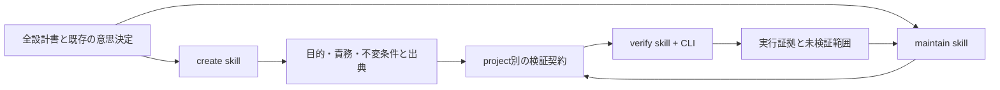

# 設計と責務

hirastack は「文書を読めば自動で正しい設計が確定する」とは考えません。agent が出典と実装の両方を読んで契約を作り、決定できないことは未決として残します。CLI はその契約を点検・実行し、同じ対象と証拠に結び付けます。

汎用 runner は文書hash、引用範囲hash、文書追加/削除、origin、必須要件と検証の参照を検査します。実装変更を禁止する baseline pin にはしません。実装後に同じ設計を検証するため、実行時の commit、可視ファイル全体のdigest、Git状態を記録し、実行中に内容が変われば合格を無効にします。ignoredファイル、依存パッケージ、環境変数、実行バイナリの同一性まではこのdigestの対象にしません。

契約が stale の場合はコマンドを起動しません。単にhashを更新する auto-refresh はありません。未解決の意味差異がある要件でも、その独立した検証は実行して結果を残せますが、要件全体を合格にはできません。提案・歴史的要件は報告に残し、現在の必須契約から除外します。

コマンドは argv 配列で渡し、shell は起動しません。command 自体は任意のコードを実行できるため、信頼できる契約だけを対象にします。`--execute` はその読者に実行を明示させる CLI 上の選択であり、新しい外部操作や本番アクセスの承認ではありません。継承する環境、コード、localhost listener はsandboxではありません。

各コマンドは独立process groupで有限実行し、終了・timeout時にそのgroupの残存を停止します。POSIX psでそのgroupに実行中processがないことを確認してからcanonicalな専用TMPDIRを削除します。観測・停止を確認できなければblockedとしscratchを保持します。ログとhelperがevidence直下へ保存した証拠は残します。別sessionへdaemonizeした子や、remote実行の終了は保証できません。長期serviceは検証helperが owned PID と readiness/doctor を管理し、finallyで停止と証拠存続を確認します。親への強制kill時はhelperのfinallyが動かない可能性があり、cleanup結果がないrunは不完全です。

runnerとargvで指定したbundle helperのhashは実行前後で比較し、途中変更は合格を無効にします。helperが別途importするbundle fileの推移的pin、検査間に一時変更して戻す操作、依存packageや実行binaryのattestationまでは保証しません。

意味の正しさは契約の引用・scope・観測方法のレビューが必要です。exit 0も偽装できるので、Node testは非空のTAP totalsとzero skip/cancel/failを要求します。それでも「検証項目が本当に要件を証明するか」は別の責務です。HABではこの限界を、保存前ACK、直接/間接依存、正常再起動とcrashの混同を対象に具体化しています。
