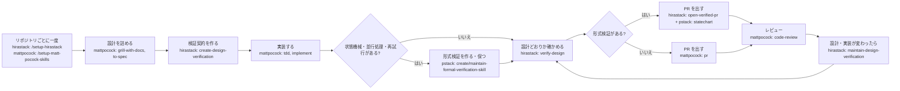

# mattpocock/skills・pstack との使い分け

hirastack は、設計書の意図を検証契約として残し、変更のたびにそれを確かめる部分を受け持ちます。設計を詰める、実装する、形式モデルを作る、といった作業は [mattpocock/skills](https://github.com/mattpocock/skills) と [pstack](https://github.com/cursor/plugins/tree/main/pstack) のスキルに任せます。どれも agent が名前と役割で選ぶもので、hirastack は相手のスキルの中身をコピーしません。

## 段階ごとの役割

| 段階 | 使うスキル | hirastack との受け渡し |
| --- | --- | --- |
| 初回設定 | hirastack の setup-hirastack、mattpocock の setup-matt-pocock-skills | 検証契約の置き場所・CLI・既存の検証スキルを `CLAUDE.md` か `AGENTS.md` の `## hirastack` 節に記録し、ほかの hirastack スキルがそれを読む |
| 設計を詰める | mattpocock の grill-with-docs、to-spec | ここで書かれた設計書が、create-design-verification の読む入力になる |
| 検証契約を作る | hirastack の create-design-verification | 全設計書を読み、目的・責務・不変条件を出典付きの契約とプロジェクト用 verify スキルにする。pstack の create-verification-skill を元にしている |
| 実装する | mattpocock の tdd、implement | 契約に結び付いたテストは、verify-design の実行対象になる |
| 形式検証 | pstack の create-formal-verification-skill、maintain-formal-verification-skill | 状態機械や並行処理のモデルを作る。open-verified-pr はこれを役割で見つけて最新化を任せる |
| 確かめる | hirastack の verify-design | 契約の検査を実行し、証拠と未検証範囲を報告する |
| PR を出す | 形式検証があれば hirastack の open-verified-pr（pstack の statechart で状態遷移図を描く）、なければ mattpocock の pr | open-verified-pr は明示的に呼んだときだけ動く |
| レビュー | mattpocock の code-review | PR 本文の図と検証範囲を前提に、図の外を読む |
| 保守 | hirastack の maintain-design-verification | 設計書・実装・依存の変化を分類し、要件を弱めずに契約を直す |

どの段階でも、hirastack の CLI は意味や優先順位を決めません。設計の解釈と、どのスキルを使うかは agent と利用者が決めます。
